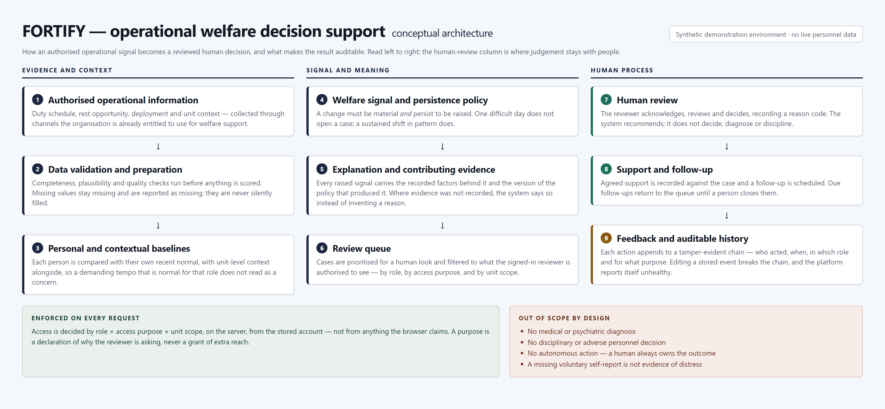

# Architecture Overview

This describes the system conceptually. The implementation is not published in this repository — there is no source code, build output or deployment material here — so this page explains how the parts relate and where the boundaries sit, not how to rebuild them.

## The nine layers

### 1. Authorised operational information

The inputs are the operational facts an organisation already holds for legitimate welfare-support purposes: duty schedule, rest opportunity, deployment and unit context. Nothing here depends on medical records, psychological assessments or private disclosures. Personnel identity is kept out of the analysis path further than it needs to be; the analysis world is described in pseudonymous person-day terms.

### 2. Data validation and preparation

Quality checks run **before** anything is scored: completeness, plausibility, range and consistency. Missing values remain missing and are reported as missing. This is where the project draws its hardest line — a gap in the data is never converted into an inferred value, because an inferred value becomes an unfalsifiable reason to look at someone.

### 3. Personal and contextual baselines

Two references are maintained: what is normal for **this person** recently, and what is normal for **their unit** in the same operational window. A signal is a departure from the personal baseline considered against the contextual one. This is what keeps a demanding but ordinary tempo from filling the queue.

### 4. Welfare signal and persistence policy

A ranking model contributes a score here, alongside a simple operational rule that the project's own evaluation found to be stronger at the deployed operating point. The policy layer decides what actually becomes a case: the change must be material, it must persist, duplicates are suppressed, and items that recover on their own are retired. Review capacity is applied as a budget at this boundary, and suppressions are recorded rather than hidden.

### 5. Explanation and contributing evidence

For each admitted case, the recorded contributing factors are assembled with their provenance: the computed value, the reference it was compared against, the window, the admission rule, and the policy version. If no evidence was recorded for a case, the explanation is explicitly unavailable. Explanations are **associative** — they describe operational factors associated with a higher signal, not causes of how someone feels.

### 6. Review queue

The queue is the contract between analysis and judgement. It is prioritised, scoped to the signed-in reviewer's authorisation, and bounded by the capacity budget. Each row is actionable on its own: what changed, how current the data is, and what the recorded factors are.

### 7. Human review

A reviewer acknowledges, reviews and decides, recording a reason code. The state machine is enforced: invalid transitions are refused, and a concurrent second reviewer cannot silently overwrite the first. Nothing in this layer happens automatically.

### 8. Support and follow-up

Agreed support is recorded against the case, together with operational feasibility — whether it can be scheduled now, only with adjustment, or is constrained by current duties. A follow-up carries a date and stays due until a human closes it. Feedback is captured with protection against accidental duplicate submission.

### 9. Feedback and auditable history

Every action appends to a hash-chained record: who acted, when, in which role, for what declared purpose, on which case. The chain is verified as part of the platform's own readiness check, so a broken chain changes the system's reported health instead of passing unnoticed. A governance view exposes the trail to audit-purpose accounts with personnel identifiers stripped.

## Two cross-cutting bands

**Access control, enforced on every request.** Role × access purpose × unit scope, resolved on the server from the stored account. A purpose is a declaration of *why* the reviewer is asking and never a grant of extra reach. Out-of-scope individuals resolve to "not found", identical to the response for someone who does not exist.

**Out of scope by design.** No diagnosis, no disciplinary or adverse personnel decision, no autonomous action, and never a missing voluntary self-report treated as evidence of distress. These are construction rules: the fields that would enable them are excluded from the analysis path, and the operations that would perform them do not exist in the workflow.

## Two runtimes, one analysis

| | Analysis and workflow platform | Hosted pilot runtime |
|---|---|---|
| Purpose | Produces the features, baselines, signals, explanations, policy decisions and workflow behaviour, and is where the evaluation was run | Serves the verified output to reviewers over an authenticated session and records their actions |
| Data | The full synthetic longitudinal environment | A compact, precomputed bundle with per-file checksums and a recorded source commit |
| Inference | Performs the analysis | **None at request time** — it delivers analysis that was done reproducibly elsewhere, and does not claim otherwise |
| Verification | Behaviour tests, evaluation and validity probes | Live-process HTTP checks, database integration checks, in-browser verification, graceful-shutdown check |

The split exists because a hosted reviewer-facing service should not be re-deriving welfare signals on demand behind an opaque endpoint. It makes the numbers traceable to a specific dataset and commit, and it turns a partially uploaded dataset into a startup failure instead of a page full of plausible-looking nothing.

## Boundaries worth stating plainly

- **Identity does not travel further than it must.** The analysis path works in pseudonymous terms; identifiers are re-associated only where an authorised reviewer's scope permits a view, and are stripped from audit-facing tables.
- **Voluntary wellness data does not enter the analysis path at all** — enforced by construction, not by convention.
- **The browser is never the authority.** Nothing about who a reviewer is, what purpose they hold or which units they may see is accepted from the client.
- **The audit record is not trusted because it is convenient.** It is verified, and the platform reports itself unhealthy when verification fails.
