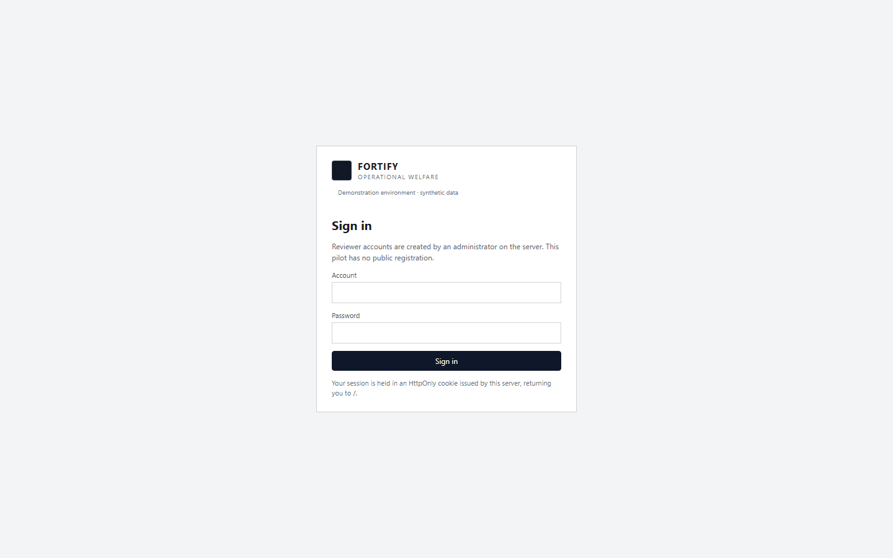
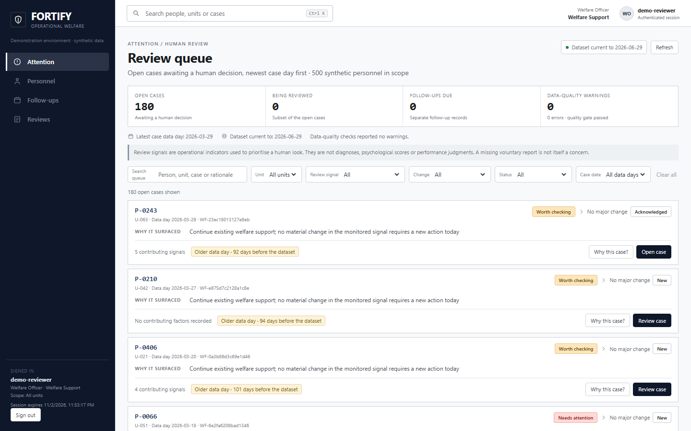
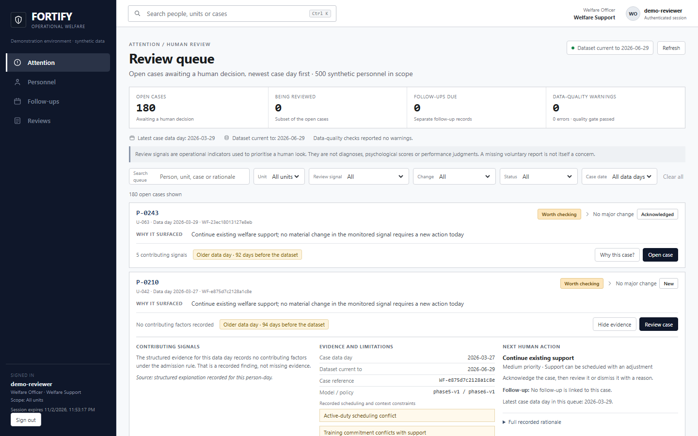
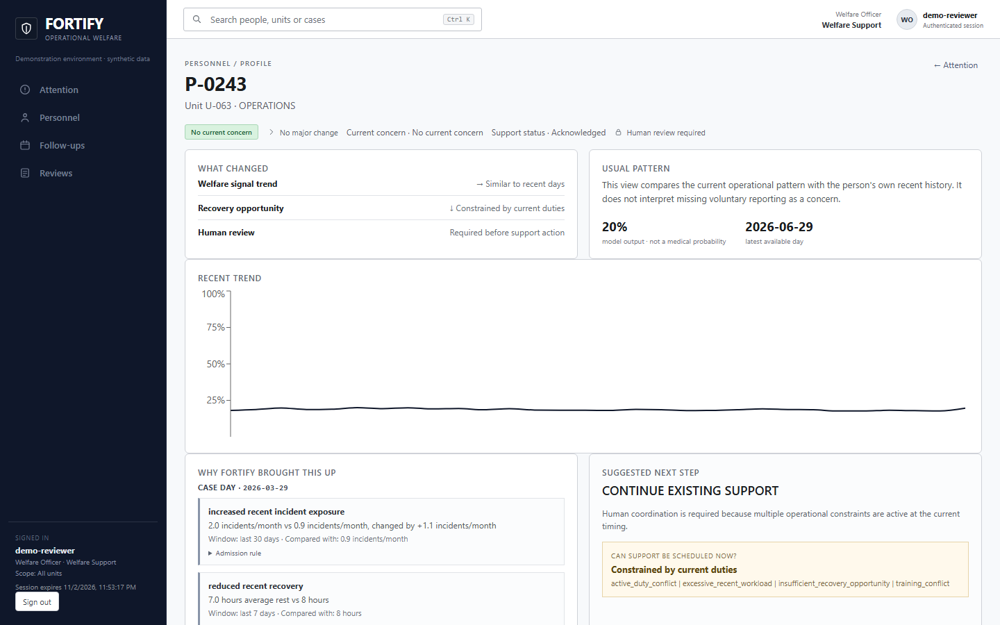
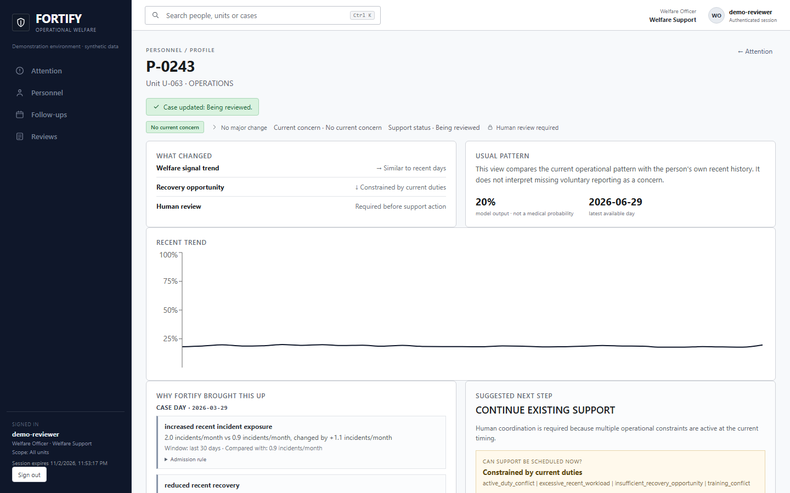
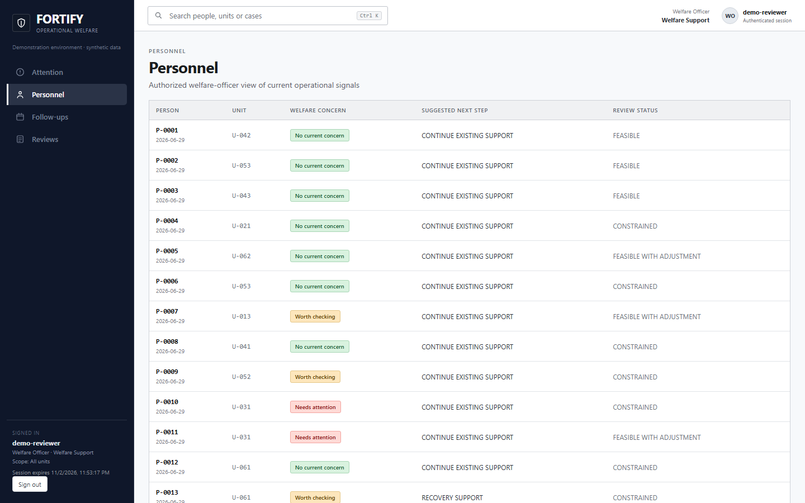
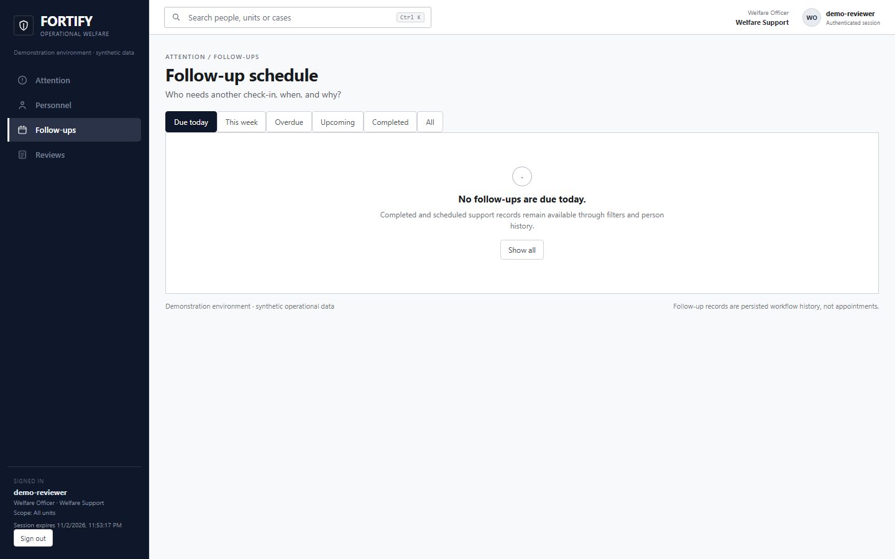
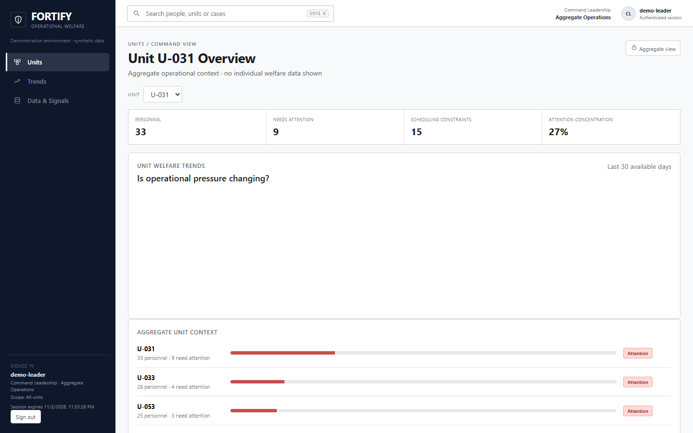
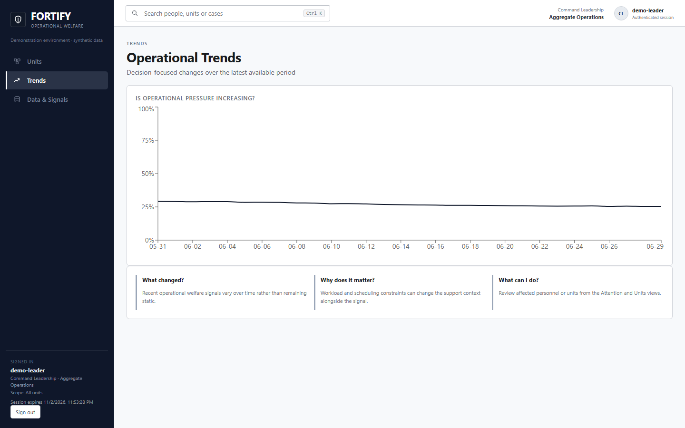
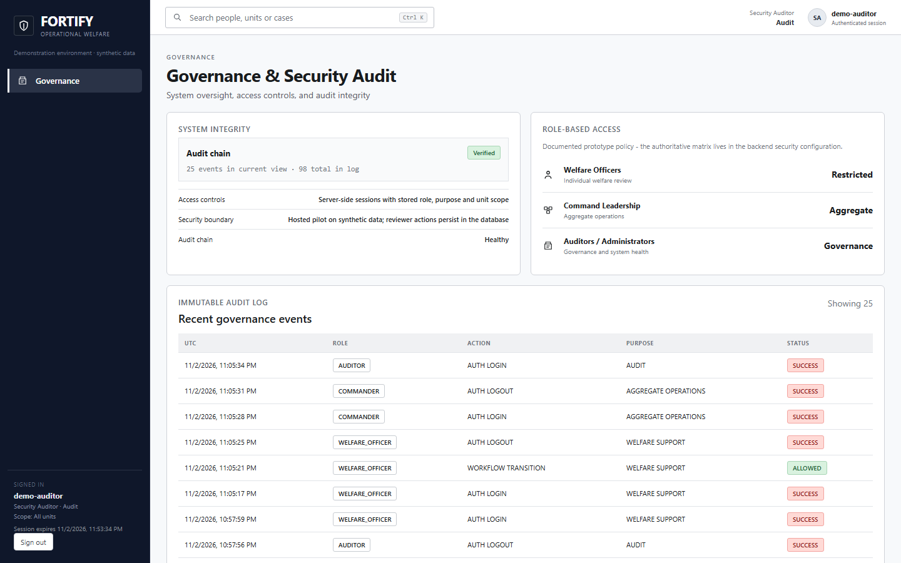

# Demonstration Guide

## Before reading the screens

The demonstration environment is **synthetic**: a reproducible generated world of 500 personnel over 180 days. The identifiers shown (`P-0313`, `U-051` and similar) are generated pseudonyms for generated people. No real personnel, departmental or wellness data appears anywhere.

**There is no public demo URL.** The application has not been deployed to a live instance, so no link is advertised here — a link that returns an error page would misrepresent the project's state. The screenshots below were captured from the application running locally, driven through a real browser against the real service, and every screen is the actual product rather than a design mockup. Access to a running instance can be arranged for evaluators on request.

Reviewer accounts are created on the server by an administrator. There is no public registration and no shared demo user.

| | |
|---|---|
|  | **Sign-in.** The screen states plainly that accounts are provisioned server-side. A wrong password and an unknown account produce the same message, so the form cannot be used to enumerate who has an account. The session lives in an HttpOnly cookie issued by the server — nothing about who you are is stored in the browser, and the interface says "Demonstration environment · synthetic data" in two places. |

---

## A welfare officer's path

### 1. The attention queue

What a reviewer is handed each morning:

- **Header counts** — open cases awaiting a human decision, how many are actively being reviewed, follow-ups due, and data-quality warnings. In this environment the quality gate reported no errors and no warnings, and the interface says so rather than staying silent.
- **Currency, stated twice** — the latest case day and the dataset's as-of date. A reviewer can see immediately that they are looking at a fixed analysis window, not a live feed.
- **A standing disclaimer** — review signals are operational indicators used to prioritise a human look; they are not diagnoses, psychological scores or performance judgements, and a missing voluntary report is not itself a concern.
- **Cases, newest first**, each with a concern level, the unit, the data day, a stable case reference, and a plain-language "why it surfaced" line — including "Continue existing welfare support; no material change in the monitored signal requires a new action today" for cases that remain open without a new reason.
- **A staleness chip on each case** — "Older data day · 84 days before the dataset". The system tells the reviewer when its own evidence is old instead of letting it read as current.
- **Scoped filters** — search, unit, review signal, change, status and case day, all bounded by what this account may see.

### 2. Contributing evidence, opened

"Why this case?" expands the recorded factors behind the entry. Three things are worth noticing:

- Cases carry a **count of contributing signals** — one, two, five — or an explicit **"No contributing factors recorded"** / "Signal detail not recorded". The absence is shown as an absence. Nothing is invented to fill the gap, which is the difference between an explanation and a story.
- Where factors exist, they trace to computed operational values and the policy that admitted the case.
- The staleness chip stays visible inside the evidence, so a reviewer cannot expand a case and lose the context that the underlying day is old.

### 3. The person's case in depth

Opening a case brings together: current concern and trend against **that person's own baseline**; the suggested next step; whether support can actually be scheduled now, only with adjustment, or is constrained by current duties; and the human-review panel with the transitions this account may perform. Where the case was opened on a different day than the latest signal, the panel says so — a case stays open until a human closes it, and the interface does not pretend otherwise.

### 4. A decision, recorded

After a reviewer acts, the state changes, the action appears in the visible history with **who acted, in which role, and for what reason code**, and the change survives a full page reload **and** a completely new sign-in — it is stored server-side, not held in the page. Invalid transitions are refused rather than silently accepted, and a second reviewer acting concurrently cannot overwrite the first without a conflict being raised.

### 5. The directory, and what comes back

The personnel directory is limited to the units this account is authorised to see — the same 500-person synthetic roster, filtered by scope rather than by what the browser claims.

The follow-up schedule is where the "support was offered" claim becomes checkable: what is due, when it was agreed, whether it is overdue, and what closes it. Nothing here completes itself.

---

## A command account's path — aggregate only

An account whose purpose is aggregate operations sees **unit-level counts and trends** — personnel, who needs attention, scheduling constraints, attention concentration — with an explicit "aggregate view" marker and a note that individual personnel identifiers are not exposed on the screen.

Trend analysis over the demonstration period, again at aggregate level.

Two things were verified about this account rather than assumed:

- **Its navigation offers 3 of the 8 areas.** Nothing it cannot open is presented as available.
- **Typing the welfare queue URL directly produces a restricted message with zero case data rendered.** The refusal is real, and the backend remains the authority — navigating directly changes nothing about what the server will answer.

---

## An audit account's path

The governance view is the accountability surface: system integrity including the **tamper-evident audit chain and its verification status**, the documented role-based access policy, and the recent action trail — timestamp, role, action, purpose and outcome. Personnel identifiers are stripped from this view.

This is not decoration. During verification, a stored audit event was deliberately altered; the readiness check then reported the platform **unhealthy** and the governance view reported the chain invalid with a reason. Restoring the stored value returned it to healthy.

---

## What to look at to judge this honestly

| Look for | Why it matters |
|---|---|
| The "no contributing factors recorded" state | Proves the system does not manufacture explanations |
| The "older data day" chip | Proves it discloses the staleness of its own evidence |
| The data-quality counts in the header | Proves quality gates are surfaced to the user, not buried in logs |
| A restricted view for a purpose-mismatched account | Proves access control is enforced rather than cosmetic |
| The action history after a decision | Proves human judgement is recorded as the author of the outcome |
| The synthetic-data labelling in the sidebar, header and banner | Proves the demonstration boundary is visible to the person using it, not only in the documentation |

## What this demonstration does not show

It does not show real personnel data, real-world accuracy, a live deployment, integration with a departmental identity provider, or a phone-width layout that works — the narrow-viewport shell is broken and is described in [LIMITATIONS_AND_FUTURE_SCOPE.md](LIMITATIONS_AND_FUTURE_SCOPE.md). Full measurement detail is in [VALIDATION_AND_EVIDENCE.md](VALIDATION_AND_EVIDENCE.md).
