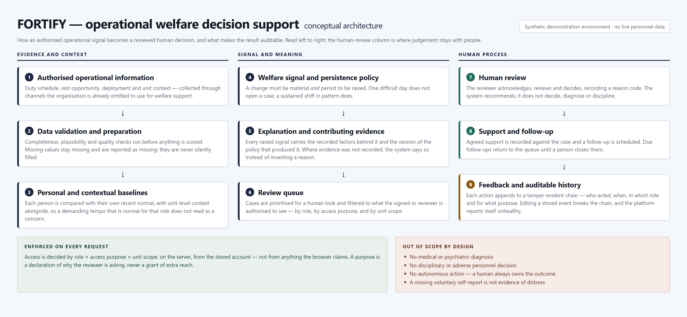
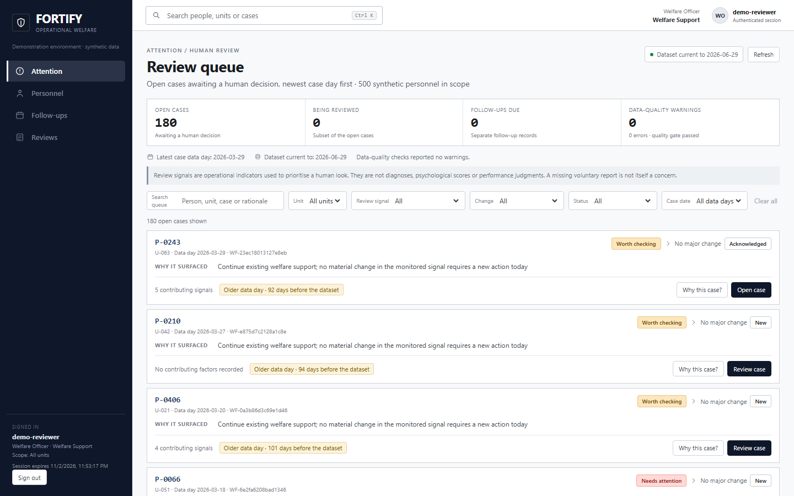
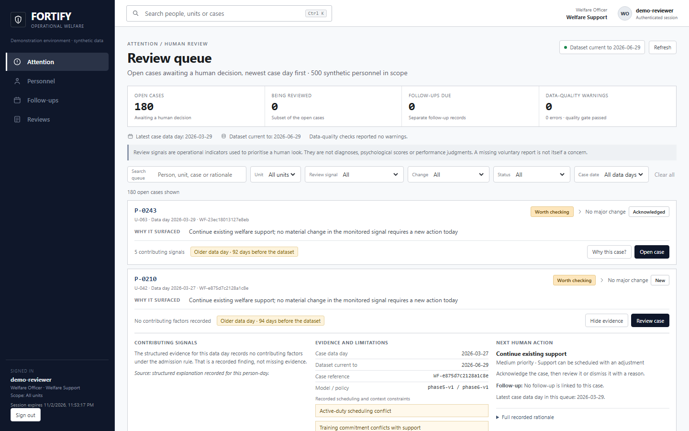
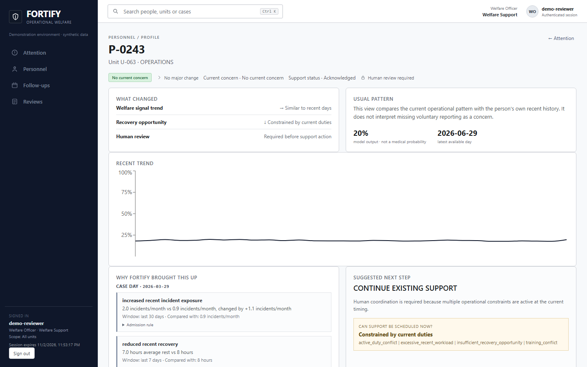
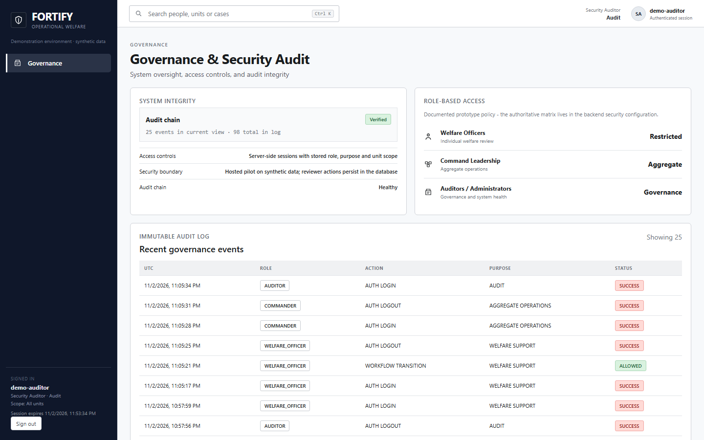

# FORTIFY

**Force Operational Resilience & Timely Intervention Framework**

*A privacy-conscious, human-in-the-loop welfare decision-support prototype for uniformed personnel.*

FORTIFY explores whether authorised operational-pattern information — duty tempo, rest opportunity, deployment and unit context — can help a welfare organisation notice a meaningful change **earlier than a referral would**, and then hand that observation to a human being with enough context to act on it proportionately. It ranks nothing into a decision: every signal it raises arrives with the recorded factors behind it, is filtered to what the signed-in reviewer is authorised to see, and only ever moves forward through an explicit human action that is written to a tamper-evident history.

The project is a **research and demonstration prototype built and evaluated entirely on synthetic data**. It is not an approved government system, it does not diagnose, and it is not a disciplinary instrument.

---

## The problem in one paragraph

People in uniformed service work under demanding schedules, irregular duties, deployments, limited recovery time, transfers and separation from family or support networks. The information that would show someone struggling is spread across systems that were never designed to look at welfare, and in practice a concern usually becomes visible only when someone raises it — which is often after the point where proportionate, low-cost support would have helped. Meanwhile the obvious alternative, indiscriminate monitoring, is exactly what makes such systems unacceptable: it stigmatises, it invites punitive use, and it drowns the people who could help in noise. See [PROBLEM_STATEMENT.md](PROBLEM_STATEMENT.md).

## What FORTIFY proposes

Four questions, answered in order and never out of order:

1. **Who may need a welfare check?** — a change measured against that person's own recent normal, not against a population average.
2. **What has changed?** — the temporal pattern, with the baseline it is being compared to and the window it was computed over.
3. **Why is it worth reviewing?** — the recorded contributing factors and the policy version that admitted the case, or an explicit statement that no evidence was recorded.
4. **What can an authorised human reasonably do?** — non-punitive support options, whether they are operationally schedulable right now, and a follow-up that stays open until a person closes it.

A model score is **evidence for a review**, not a decision. Full detail in [SOLUTION_OVERVIEW.md](SOLUTION_OVERVIEW.md).

## Product principles

| Principle | What it means in this prototype |
|---|---|
| Human judgement remains authoritative | No automated diagnosis, punishment or adverse personnel decision. The system cannot close a person's case for them. |
| Signals must be explainable | Every displayed factor traces to a computed value, a reference baseline, a time window and an admission rule. |
| Context matters | A deviation from the global average is not evidence of a welfare concern. One difficult day does not open a case. |
| Purpose limitation | Individual-level access requires role, access purpose **and** unit scope, decided on the server from the stored account. Leadership visibility is aggregate-first. |
| Voluntary wellness stays voluntary | A missing self-report is never treated as proof of distress, and raw voluntary responses are excluded from the analysis path by construction. |
| Follow-through matters | The workflow covers support, feedback, follow-up, closure, reopening and audit — not just predictions. |

---

## How the system is shaped

Nine layers, read left to right: authorised operational information → validation and preparation → personal and contextual baselines → welfare signal and persistence policy → explanation and contributing evidence → review queue → human review → support and follow-up → feedback and auditable history. Two bands run across the whole design: access control is enforced on every request, and the out-of-scope list (diagnosis, discipline, autonomous action, self-report absence as evidence) is not a policy document but a construction rule. Prose version: [ARCHITECTURE_OVERVIEW.md](ARCHITECTURE_OVERVIEW.md).

## Live demonstration access

The hosted demonstration is available at **https://fortify.urbantechx.in**. It uses synthetic demonstration data and three shared, pre-provisioned accounts:

| Demo role | Username | Password |
|---|---|---|
| Welfare reviewer | `demo-reviewer` | `DemoAdmin@666` |
| Commander (aggregate view) | `demo-leader` | `DemoAdmin@666` |
| Security auditor | `demo-auditor` | `DemoAdmin@666` |

These are deliberately public demonstration credentials, not private reviewer accounts. The accounts share a demonstration environment: workflow changes may be visible to other visitors and may be reset during maintenance. Use them only to explore synthetic records. **Do not enter real names, personal information, operational records or confidential material.** There is no public registration.

For the role-specific walkthrough and expected restrictions, see [DEMONSTRATION_GUIDE.md](DEMONSTRATION_GUIDE.md).

## What a reviewer actually sees

| | |
|---|---|
|  | **The attention queue.** Open cases, newest case day first, each with its concern level, the reason it surfaced, how many contributing signals are recorded, and an explicit chip when the underlying data day is stale relative to the dataset. |
|  | **Evidence, opened.** "Why this case?" expands the recorded operational factors for that person-day, with the policy provenance. Where nothing was recorded, the panel says so rather than inventing a reason. |
|  | **One case in depth.** Current concern, the trend against that person's own baseline, the suggested next step, whether support can actually be scheduled given operational constraints, and the human-review panel. |
|  | **Governance, for an audit-purpose account.** The tamper-evident action trail — who acted, when, in which role, for what purpose — with chain verification status. Personnel identifiers are stripped from this view. |

More screens in [DEMONSTRATION_GUIDE.md](DEMONSTRATION_GUIDE.md): sign-in, personnel directory, follow-up schedule, aggregate unit command view and trend analysis.

---

## What makes it different

- **A persistence policy, not a threshold.** A change must be material *and* persist before it is raised; recovery logic and duplicate suppression stop the same person occupying the queue repeatedly.
- **Review capacity is a first-class constraint.** The queue is budgeted. Anything that would not be read is suppressed and the suppression is recorded, so the burden is visible instead of hidden in a score list.
- **Explanations carry provenance or admit absence.** Computed value, reference, window and admission rule — or an explicit "not recorded". No post-hoc narrative dressed up as evidence.
- **It published the result where the model lost.** At the deployed operating point, a simple operational rule scored **F1 0.614** against the trained model's **0.322**. Loosening the threshold lifted the model to about 0.633 but required flagging roughly **54 % of person-days** — an unreviewable load. The architecture decision that followed was to keep the model as *one ranking signal inside a bounded, human-owned queue* rather than as a decision-maker. Full numbers in [VALIDATION_AND_EVIDENCE.md](VALIDATION_AND_EVIDENCE.md).
- **Access is three-dimensional and server-side.** Role × access purpose × unit scope, resolved from the stored account. A reviewer declaring a purpose is stating *why* they are asking, never gaining reach — measured, including the refusal.
- **The audit trail is tamper-evident and self-reporting.** Events are hash-chained; editing a stored event breaks the chain, and the platform reports itself unhealthy rather than continuing to look normal.

Innovation in context: [INNOVATION.md](INNOVATION.md).

## What has actually been verified

| Evidence | Measured result |
|---|---|
| Behaviour test suite (analysis platform) | **450 passed, 4 skipped**, exit code 0, on a scratch database; the demonstration store was byte-identical afterwards |
| Hosted pilot runtime tests | **42 passed, 0 failed, 1 skipped** across the pilot API suite; the Linux SIGTERM shutdown check also passed |
| Frontend checks | **29** tests passing, type check clean, production build clean |
| Live browser verification | **37 of 37** steps passed on the hosted site across reviewer, commander and auditor journeys; a reviewer workflow action survived a hard reload and a new sign-in; responsive layout was measured at 390, 414, 768 and 1440 px |
| Live PostgreSQL path (reference implementation) | **3 of 3** checks passed on PostgreSQL 16.15 in a throwaway container |
| Database compatibility | The hosted pilot is connected to **MariaDB 10.11.19**; the initial migration created 12 tables and the live audit chain verified. The disposable-database integration and backup→restore→verify drill passed on MariaDB 10.11.19; a restorable backup of the live cPanel database has not yet been obtained |
| Runtime floor | The service starts, serves requests and shuts down cleanly on **Node.js v20.20.2**, the documented minimum |
| Data provenance | A reproducible **500-personnel, 180-day** synthetic environment; the served bundle carries its source commit and per-file SHA-256 checksums, verified at startup |

What remains unverified is listed in [LIMITATIONS_AND_FUTURE_SCOPE.md](LIMITATIONS_AND_FUTURE_SCOPE.md): no real-world validation or institutional approval; Oracle MySQL 8 compatibility; a restorable backup of the live cPanel database; the cause of two intermittent HTTP 503 responses observed during an earlier run (not reproduced in the subsequent 37/37 run); independent penetration testing; and a dependency-CVE advisory check.

## Responsible use statement

FORTIFY is a research and demonstration prototype on synthetic data. Synthetic metrics do not establish clinical, occupational or operational effectiveness, and no real-world predictive performance is claimed. Explanations are **associative, not causal** — they describe operational factors associated with a higher signal, not why a person feels as they do. Moving this toward a real pilot requires an institutional sponsor and policy owner, an authorised identity provider and data contract, a privacy and security assessment, prospective validation on authorised data under approvals, and a human-factors evaluation for stigma, over-reliance, punitive interpretation and alert fatigue, with stop criteria agreed before any supervised pilot. No government deployment, official approval or procurement status is claimed.

## Future scope

Authorised data contracts and provenance; real identity integration with provisioning and revocation; managed hosting with tested recovery; retention and deletion policy with measured RPO/RTO; prospective validation against simple baselines at realistic review capacity; human-factors study; and — only with institutional authorisation — narrow, consented pilots. Detail in [LIMITATIONS_AND_FUTURE_SCOPE.md](LIMITATIONS_AND_FUTURE_SCOPE.md).

## Repository contents

| Document | About |
|---|---|
| [PROJECT_OVERVIEW.md](PROJECT_OVERVIEW.md) | What the project is, who it is for, current status |
| [PROBLEM_STATEMENT.md](PROBLEM_STATEMENT.md) | The gap being addressed and the harm model |
| [SOLUTION_OVERVIEW.md](SOLUTION_OVERVIEW.md) | How it works, in plain terms |
| [INNOVATION.md](INNOVATION.md) | Differentiation, claim by claim |
| [FEATURES.md](FEATURES.md) | Implemented vs planned, explicitly separated |
| [ARCHITECTURE_OVERVIEW.md](ARCHITECTURE_OVERVIEW.md) | The nine layers and the boundaries between them |
| [VALIDATION_AND_EVIDENCE.md](VALIDATION_AND_EVIDENCE.md) | Measured figures and what each gate proves |
| [LIMITATIONS_AND_FUTURE_SCOPE.md](LIMITATIONS_AND_FUTURE_SCOPE.md) | Honest limits and the path forward |
| [DEMONSTRATION_GUIDE.md](DEMONSTRATION_GUIDE.md) | A reviewer's walkthrough, screen by screen |
| [RIGHTS_NOTICE.md](RIGHTS_NOTICE.md) | Ownership and permitted use of these materials |

## Team

Designed, implemented and evaluated by **Naaman Jain** (GitHub: `naamanjain`), as recorded in the project's own commit authorship. The licence file in the private engineering repository names "FORTIFY Contributors" as the copyright holder; that holder string is reproduced here rather than upgraded into a claim about a legal entity.

## Acknowledgements

Evaluation methodology and honest-reporting discipline draw on the standard practice of comparing a learned signal against a simple operational rule at realistic review capacity, and on the human-subject-research convention that a decision-support tool for welfare must be assessed for stigma and over-reliance before it is assessed for accuracy. Third-party material in this repository: none — the screenshots and the diagram were produced from this project's own code and assets, using system fonts only.

---

**This repository presents project materials for evaluation and informational review only. It contains no implementation source code, no build artefacts and no deployment packages. See [RIGHTS_NOTICE.md](RIGHTS_NOTICE.md).**
